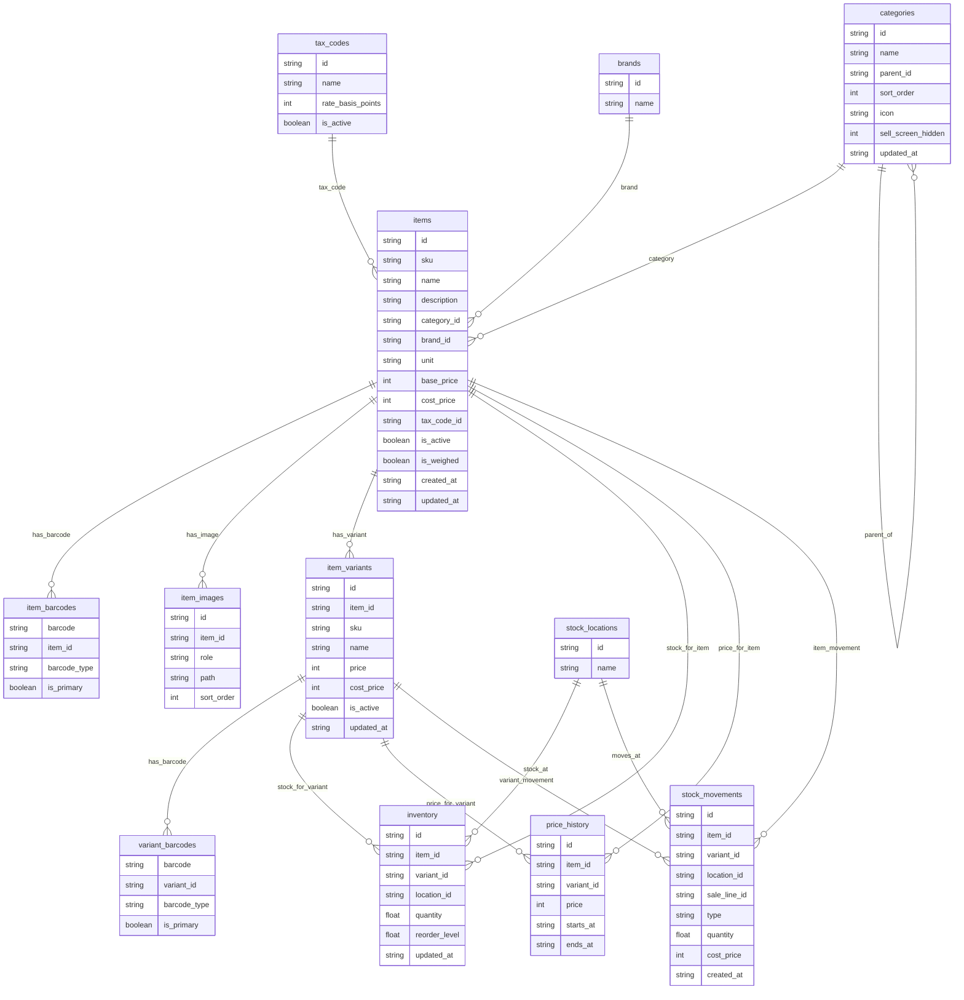
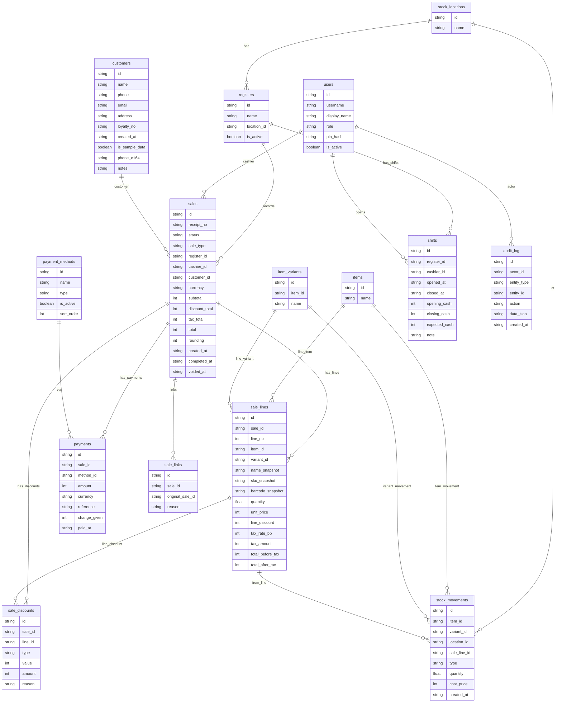

# UniversalTill Data Model (SQLite)

This document describes the physical relational schema implemented by `001_init.sql`
and subsequent migrations.

- DB engine: SQLite
- Migrations: `internal/db/migrations/*.sql` — `001_init.sql` is a single
  squashed baseline (ADR-0074, 2026-09): a dump of the schema plus every seed
  row the previous 78-file ledger produced. Every migration file, `001_init.sql`
  included, is frozen the moment it merges to `main` (ADR-0100, which withdrew
  ADR-0074's "editable until the first paying shop" allowance after ut-docs#2395):
  schema and seed changes are always a new, higher-numbered file, and
  `internal/db/shipped_migrations_test.go` pins every file's checksum in CI.
- Ledger: `schema_migrations(version, applied_at, name, checksum)` is created
  by `internal/db/db.go`, never by a migration file. On every boot the runner
  compares each applied version's recorded `name`/`checksum` with the on-disk
  file and refuses to start on a mismatch (a file renamed or edited after being
  applied) rather than silently skipping a step.
- Lineage: `schema_lineage(id=1, reset_marker, reset_at)` is written by the
  baseline. A database with ledger rows but no lineage row predates the reset
  and `db.Open` refuses it with "database predates the schema reset — delete
  the data directory and start again"; there is no upgrade path from the
  pre-reset schema by design.
- Foreign keys: `PRAGMA foreign_keys = ON`

## Money & quantities

- All monetary values are stored as INTEGER minor units (pence).
- Quantities:
  - `REAL` is used where items can be weighed (`unit = 'kg'` and `is_weighed = 1`).
  - Otherwise they represent whole units.

## Table groups

### 1. Lookup & configuration

- `schema_migrations`
- `schema_lineage`
- `settings`
- `tax_codes`
- `categories`
- `brands`
- `stock_locations`

(then briefly describe each, you can copy from the constitution section above)

### 2. Catalog

- `items`
- `item_barcodes`
- `item_images`
- `item_variants`
- `variant_barcodes`

Barcode type is validated at the catalog repository boundary. An explicit
`EAN13` value must contain exactly 13 digits and a valid EAN-13 check digit;
an omitted type is inferred as `EAN13` for 13-digit values and otherwise stored
as `CODE128` so internal PLU/keypad codes remain supported.

### 3. Inventory & pricing

- `inventory`
- `price_history`
- `stock_movements`

### 4. Sales & payments

- `sales`
- `sale_lines`
- `sale_discounts`
- `payments`
- `sale_links`
- `sales_aggregate_uploads` — which daily per-till sales rollups the cloud
  has accepted (content-hash ledger for the ADR-0111 upload,
  ut-docs#2535; migration 038)
- `no_sale_events` — "No sale" cash-drawer opens (`POST /api/pos/no-sale`,
  gated by the `cash_adjustment` permission or a manager PIN; recorded only
  after the drawer kick reached the printer). Append-only; `local_date` and
  the till key (`till_id`, else `register_id`) follow the sales rules, so
  the ADR-0111 rollup reports them as `no_sale_count` and
  `by_cashier[].no_sale_opens` (ut-docs#2558; migration 064, with its
  `no_sale_events_archive` reset twin). A replica journals its own opens
  to the main till over LAN sync D3 (`POST /api/sync/no-sales`, cursor
  `sync.no_sale_push_cursor`), where they are stored with `till_id` = the
  reporting till's `tills.id`, so the main till's rollup counts every
  till's opens once (ut-docs#3562)

### 5. Shifts & audit

- `shifts`
- `audit_log`

### 6. Parties & tills

- `customers`
- `users`
- `registers`

### 7. Plugins & shortcuts

- `plugin_catalog`
- `plugins`
- `plugin_entries`
- `plugin_settings`
- `plugin_hooks`
- `plugin_permissions`
- `shortcut_buttons`

## ER Diagram

# 1️⃣ Core POS – High-level Overview

```mermaid
erDiagram

    items {}
    item_variants {}
    item_barcodes {}
    item_images {}
    variant_barcodes {}
    tax_codes {}
    categories {}
    brands {}
    stock_locations {}
    inventory {}
    price_history {}

    customers {}
    users {}
    registers {}
    payment_methods {}

    sales {}
    sale_lines {}
    payments {}
    sale_discounts {}
    sale_links {}
    shifts {}
    stock_movements {}
    audit_log {}

    plugin_catalog {}
    plugins {}
    plugin_entries {}
    plugin_settings {}
    plugin_hooks {}
    plugin_permissions {}

    shortcut_buttons {}

    %% Catalog / lookup
    categories ||--o{ categories       : "parent_of"
    categories ||--o{ items            : "category"
    brands     ||--o{ items            : "brand"
    tax_codes  ||--o{ items            : "tax_code"

    items         ||--o{ item_barcodes : "has"
    items         ||--o{ item_images   : "has"
    items         ||--o{ item_variants : "has"
    item_variants ||--o{ variant_barcodes : "has"

    %% Inventory & pricing
    stock_locations ||--o{ inventory   : "stock_at"
    items           ||--o{ inventory   : "stock_for_item"
    item_variants   ||--o{ inventory   : "stock_for_variant"
    items           ||--o{ price_history : "price_for_item"
    item_variants   ||--o{ price_history : "price_for_variant"

    %% Sales & payments
    customers ||--o{ sales             : "places"
    registers ||--o{ sales             : "records"
    users     ||--o{ sales             : "handles"

    sales     ||--o{ sale_lines        : "has_lines"
    sales     ||--o{ payments          : "has_payments"
    sales     ||--o{ sale_discounts    : "has_discounts"
    sales     ||--o{ sale_links        : "links"

    sale_lines ||--o{ sale_discounts   : "line_discounts"
    payment_methods ||--o{ payments    : "via"

    %% Shifts & stock
    registers ||--o{ shifts            : "runs"
    users     ||--o{ shifts            : "opens"

    items         ||--o{ stock_movements : "moved_as_item"
    item_variants ||--o{ stock_movements : "moved_as_variant"
    stock_locations ||--o{ stock_movements : "moves_at"
    sale_lines    ||--o{ stock_movements : "from_line"

    %% Audit
    users ||--o{ audit_log            : "acts_in"

    %% Plugins & shortcuts
    plugin_catalog ||--o{ plugins           : "versions"
    plugins        ||--o{ plugin_entries    : "exposes"
    plugins        ||--o{ plugin_settings   : "configured_by"
    plugins        ||--o{ plugin_hooks      : "hooks"
    plugins        ||--o{ plugin_permissions: "requires"

    items ||--o{ shortcut_buttons      : "shortcut_for"

```


---
# 2️⃣ Catalog & Inventory – Rich Detail


---
# 3️⃣ Sales, Cash, Customers & Audit – Rich Detail

---
# 4️⃣ Plugins & Shortcuts – Rich Detail
```mermaid
erDiagram

    plugin_catalog {
        string id
        string version
        string name
        string description
        string author
        string website
        string repository_url
        string runtime
        string entrypoint
        string package_url
        string sha256
        string signature
        int    size_bytes
        string min_pos_version
        string max_pos_version
        string api_version
        string tags_json
        string capabilities_json
        string published_at
        boolean is_deprecated
    }

    plugins {
        string id
        string name
        string version
        string install_state           %% 'pending'|'installed'|'revoked' (009-marketplace)
        string description
        string author
        string website
        string entrypoint
        string runtime
        string installed_from_url      %% Marketplace URL or 'file://' for manual imports
        string installed_sha256        %% SHA256 checksum for integrity verification
        boolean is_active              %% Enable/disable control (Phase 5)
        string trust_level             %% 'untrusted'|'trusted'|'verified' (marketplace trust tier)
        string installed_at
        string updated_at
    }

    plugin_entries {
        string id
        string plugin_id
        string type
        string key
        string label
        string icon_path
        int    sort_order
        boolean is_active
        string parent_page_key
        string menu_group
        string route
        string target_action
        string trigger_event
        string config_json
        string created_at
        string updated_at
    }

    plugin_settings {
        string id
        string plugin_id
        string key
        string value_json
        string scope
        string scope_id
        string updated_at
    }

    plugin_hooks {
        string id
        string plugin_id
        string event
        string action
        int    priority
        boolean is_active
        string config_json
    }

    plugin_permissions {
        string id
        string plugin_id
        string permission
        boolean granted
    }

    items {
        string id
        string name
    }

    shortcut_buttons {
        string barcode
        string item_id
        string label
        string image_path
        string updated_at
    }

    %% Relationships

    plugin_catalog ||--o{ plugins           : "version_of"
    plugins        ||--o{ plugin_entries    : "exposes"
    plugins        ||--o{ plugin_settings   : "configured_by"
    plugins        ||--o{ plugin_hooks      : "hooks"
    plugins        ||--o{ plugin_permissions: "requires"

    items ||--o{ shortcut_buttons          : "shortcut_for"

```


## Promotions

- Table: `promotions(code TEXT PK, type TEXT CHECK type IN ('amount','percent') DEFAULT 'amount', value INTEGER, description TEXT, starts_at TEXT, ends_at TEXT, customer_id TEXT FK customers.id, is_active INTEGER, is_sample_data INTEGER)`
- Purpose: store coupon/promotion codes redeemable at checkout; `value` is minor units for `type='amount'` or basis points (e.g., 1000 = 10%) for `type='percent'`; optional `customer_id` for targeted promos; `starts_at`/`ends_at` bound validity.
- Seeds (001_init.sql): PROMO50 (50p), PROMO500 (£5), DISC10 (10% off) — respecting `type`. **Opt-in as of migration 038 (ut-docs#567)**, same as the demo catalogue (migration 036): not present on a fresh install unless the setup wizard's sample-data checkbox is ticked, flagged `is_sample_data = 1` when seeded, removable from Settings → Data alongside the demo customers and catalogue. `customers` gets the same `is_sample_data` column and the same opt-in/removal treatment for its 3 seeded demo rows (Alice Carter/Ben Singh/Chloe Martin).
- Usage: POS scan/discount endpoint checks active promotions (optionally matching customer) before applying barcode prefixes; basket carries `customer_id` for targeted promos.
- Constraints: no negative amounts; inactive/expired codes ignored; percent promos should cap discounts to avoid negative totals.

## Customers — phone_e164 and notes (ut-docs#3200, ADR-0131)

- Columns (migration 069): `phone_e164 TEXT` (indexed) and `notes TEXT`. Both are personal data: they travel to LAN replicas with the rest of the row (admin sync), are blanked on a replica's erased-customer shell (`scrubOnRetire`), and never go to the cloud.
- `phone_e164` is `internal/phonenumber.Normalise(phone, store.country)`: `'+<digits>'` (E.164); the bare digits when the phone can't be normalised; `''` when there is no phone; `NULL` = not computed yet. A trigger resets it to `NULL` when `phone` changes on its own.
- `POSRepo.BackfillCustomerPhoneE164` fills `NULL` rows in chunks, in the background after start-up on every till (main and replica); when `store.country` differs from the per-till marker `customers.phone_e164_region` it recomputes every row first. Idempotent.
- `POSRepo.LookupCustomersByPhone` (caller ID): every non-erased customer whose `phone_e164` equals the caller's normalised number, else matches on the trailing 9 digits; at most 10, by name, each with its last 5 completed sales (date, total, line count). Rows still `NULL` are normalised in Go, so the lookup is right before the back-fill finishes. Migration 069 also adds `idx_sales_customer_id` for the last-5-sales query.

## Cloud catalogue pull — cloud_links (ut-docs#4463, ut-docs#4491, ut-docs#4521, ADR-0162 §4)

On a paid store whose catalogue the cloud masters, the **main till** pulls the
cloud's catalogue feed (ut-docs `reference/contracts/cloud-catalog-feed.md`,
`GET /v1/stores/catalog`) and applies it through its own repositories
(`internal/catalogpull`, called from `internal/cloudsync`'s tick).

- **When.** Only when all hold: this till is the main till (no
  `sync.primary_url`), the cached `entitlement.catalog_master` is exactly
  `cloud` (the sync response's entitlement block; anything else reads as
  `till`), and this tick's check-in POST reached the cloud (a 304 check-in
  means nothing changed). A pull failure is logged and retried on the next
  trigger; it never fails the check-in and never touches the sale path.
  Replicas get the result over LAN admin sync like any other catalogue edit.
- **Tables (migration 082, main-till only, never LAN-synced).**
  `cloud_links(entity, cloud_id, local_id, version, gen, updated_at, PK(entity, cloud_id))`
  maps a cloud row to its local record (index on `(entity, local_id)`); a
  cloud-created row's local id is its `cloud_id`. `gen` is the resync
  generation that last saw the row. `cloud_apply_failures(entity, cloud_id,
  version, reason, at)` keeps the latest refusal per cloud row until a later
  version of it applies.
- **State (settings, per-till `cloudsync.` family).**
  `cloudsync.catalog.cursor` (highest version fully applied),
  `cloudsync.catalog.applier_version` (a stored value below the code's
  `catalogpull.ApplierVersion` resets the cursor to 0 — a full re-pull),
  `cloudsync.catalog.gen` and `cloudsync.catalog.resync_gen` (a resync in
  progress).
- **Apply.** Pages are applied in transactions of at most 100 rows, one
  savepoint per row. The cursor is written in the chunk's transaction and only
  at a version boundary, so a crash re-applies at most one version, which is
  idempotent. A row the till's validation refuses keeps the till's previous
  version, is recorded in `cloud_apply_failures` (and logged), and the cursor
  still moves past it. An error that is not a refusal — the context ending,
  a SQLite failure other than a constraint (`data.IsStorageError`), a failed
  savepoint, a hook such as the live-basket check failing — aborts the chunk
  with the cursor unchanged and records nothing. A page with more rows than
  the requested limit is refused unless all its rows share one version (the
  contract's one oversized case).
  **Order within a version.** A version group (one cloud transaction, always
  whole) is applied in dependency order, not the feed's kind/`cloud_id`
  order: tax codes, then modifier groups, then option sets, then categories
  with a parent named in the group before its children, then items, then
  item variants, then item barcodes, then every other kind. The order is settled over
  the whole group before it is cut into chunks. A parent cycle falls back to
  feed order and is refused by the normal validation. A reference
  (`parent_cloud_id`, `category_cloud_id`, `tax_code_cloud_id`, a variant's or
  barcode's `item_cloud_id`, a barcode's `variant_cloud_id`, and every id
  in `modifier_group_cloud_ids`, `modifier_opt_out_cloud_ids`,
  `option_set_cloud_ids`) to a row of that kind that has no link yet — in an
  earlier version or earlier in its group — refuses the row. An unlinked local row whose id equals the `cloud_id` is adopted
  (updated and linked; its audit row says `created: false`).
  **Seed rows (ut-docs#4494).** A fresh till runs the setup wizard before it
  can be paired, so it already holds migration 001's tax codes and the
  wizard's gift voucher item. An unlinked `tax_code` row whose (trimmed) name
  equals exactly — BINARY, as the UNIQUE constraint compares — the name of a
  seed tax code (`data.SeedTaxCodeIDs`: `tax_std`, `tax_red`, `tax_zero`) that
  no `tax_code` link points at is applied onto that seed row and linked
  (audit `adopted_seed: true`, `created: false`); from then on it is an
  ordinary linked row (a tombstone or prune deactivates it). Any other local
  row of the same name, or a seed row already linked, still refuses the row
  (general adoption is ut-docs#4465). After a run that applied at least one
  row, the seeded gift voucher item is retired
  (`POSRepo.RetireSeededGiftVoucherItem`, ut-docs#4399's rules: another active
  gift voucher item exists, the seeded one is untouched and unused) unless the
  live baskets hold it or their check fails — then the next applying run
  retries. Best-effort, after the last commit; a removal counts as a change.
  Applied kinds: `tax_code`, `category`, `item`, `modifier_group`,
  `option_set` (applier version 2, ut-docs#4491), `item_variant`,
  `item_barcode` (applier version 3, ut-docs#4521). Every other kind is
  skipped, cursor advancing: `layout`, `staff`, `setting` (ut-docs#4492),
  and any unknown kind. Each applied
  row writes an `audit_log` row (`actor system`, action
  `cloud_catalog_<kind>_saved|deleted|deactivated`).
- **Fields.** `tax_code`: name, rate_basis_points, takeaway_rate_basis_points
  (null = no override), active. `category`: name, parent_cloud_id (null = top
  level), sort_order, color, icon (null = clear), sell_screen_hidden, active
  (deactivating refuses while active items are in it). `item`: name, sku and
  unit (blank = keep), description (null = clear), price_minor,
  category_cloud_id / tax_code_cloud_id (null = clear), active, is_weighed,
  stock_untracked, age_restricted, color, icon, item_type, sell_screen_hidden,
  sell_screen_removed, net_quantity_value/unit (both null = clear).
  `modifier_group`: name, required, min_select, max_select, sort_order (the
  group row's own legacy column; not negative), active, options — the full
  ordered option set `[{id, name, price_delta_minor, active}]` (an option left
  out is deleted; an absent option `active` means active; each `id` must be a
  UUID and becomes the option's local id) — with `save_modifier_group`'s rules
  (0 ≤ min ≤ max ≤ 50, required needs min ≥ 1, unique name among active
  groups, 1–128-character option names, price change 0–999 999 999).
  `option_set`: name (unique), active, values — the full ordered value list
  `[{id, value}]` (UUID ids; a value left out is deleted, its generated
  variants stay) with `save_option_set`'s rules.
  **Link lists** — category `modifier_group_cloud_ids`; item
  `modifier_group_cloud_ids`, `modifier_opt_out_cloud_ids`,
  `option_set_cloud_ids` — are each the whole ordered set: absent keeps the
  till's links, `[]` clears them, `null` refuses the row (the contract's lists
  are never null), and every id must resolve through `cloud_links`. Applying
  an item's option sets never generates variants (they arrive as their own
  rows, ut-docs#4521). The same holds for `options` and `values`: absent
  keeps, `null` refuses.
  `item_variant` (`SaveVariantTx`, `save_item_variant`'s rules): item_cloud_id
  (required on every row; a variant never moves to another item), name, sku
  (blank = keep; blank on create generates a `VAR-` code), price_minor (not
  null), active, retired_with_item (stored only on an inactive variant), and
  option_value_cloud_ids — the variant's whole `item_variant_options` set
  (absent keeps, `[]` clears, `null` refuses; at most two ids, each an
  option value already on this till — its local id is its cloud id — and at
  most one per option set; a value of a set the item no longer uses is kept
  as provenance).
  `item_barcode` (`PutBarcodeTx`, one row per barcode, written whole):
  barcode and item_cloud_id required, variant_cloud_id null = an item
  barcode (else a variant of that item), is_primary (true demotes the
  owner's other primary). `barcode_type` is not read: the till resolves the
  code against the shop's enabled symbologies as `save_item` does (ADR-0059
  §3). The link's local id is the owner and stored key
  (`item:<id>:<key>` / `variant:<id>:<key>`), so a changed code, a move or a
  tombstone removes the barcode only from the owner the row put it on. A code
  another item or variant holds, a code another barcode row's link already
  names, or a 21st barcode on one owner refuses the row. A page's codes are
  resolved before its first transaction (resolving reads settings through
  the pool; a settings read failure aborts the chunk rather than refusing).
- **Tombstones** use the delete rules: an item that was ever sold, has stock
  history, is on a quick button, in a parked or live basket, is deactivated;
  otherwise deleted (`delete_item`'s rule). A category is soft-deleted
  (`DeleteCategoryMoving`); a tax code is deactivated. A modifier group is
  deleted with `delete_modifier_group`'s cascade (options, item and category
  links, opt-outs; past sales keep their snapshots). An option set is deleted
  when no active item has it applied, else deactivated
  (`delete_option_set`'s rule). A variant is deactivated, never deleted; a
  barcode is removed (one never pulled is a no-op). The link is removed. A resync's prune uses the
  same rules for every kind.
- **409** `catalog_master_till` / `catalog_adopting` and **401/403** (e.g.
  `device_credential_required`) stop the pull with the cursor unchanged and
  no error; a 401/403 is logged at Warn once, then at Info until the feed
  accepts the credential again.
  **410 resync** starts a new generation from cursor 0. When the full pull
  reaches `high_water`, the till fetches once more at `since=high_water`:
  only an empty page with the same `high_water` confirms it, and then every
  link with an older generation goes through the tombstone rules. Any other
  answer is applied as a normal page and the prune waits for a later run
  (`resync_gen` stays set), so on a feed written without pause the prune
  waits for a quiet run; stale links only linger meanwhile. A crash
  mid-resync still prunes at the end. Not yet built: the outbox exemption
  (ut-docs#4464) and reporting refusals back to the cloud as `apply_failed`
  (ut-docs#4493).

---

## Cloud Marketplace Integration (Feature 009)

### Overview
The marketplace integration enables POS devices to discover, install, update, and manage plugins from a central cloud marketplace. Implementation follows a **local-first** architecture where catalog data is cached locally and all plugin operations work offline.

### Plugin Lifecycle States
- **pending**: Download in progress or installation incomplete
- **installed**: Successfully installed and ready to use
- **revoked**: Disabled by marketplace due to security/compliance issues

### Trust Levels
- **untrusted**: Manual imports or unverified sources (default for file uploads)
- **trusted**: Verified by marketplace or approved developer
- **verified**: Cryptographically signed by marketplace with valid signature

### File Storage Structure
```
data/plugins/
├── cache/                    # Catalog snapshots
│   └── prod.catalog.json    # Cached marketplace catalog
├── tmp/                      # Temporary downloads
│   └── *.part               # Resume-capable partial downloads
├── auth/                     # OAuth2 credentials cache
│   └── token.json           # Marketplace access token
└── {plugin_id}/             # Plugin installations
    ├── {version}/           # Current active version
    │   ├── manifest.json    # Plugin metadata
    │   └── ...              # Plugin files
    └── versions/            # Rollback history (max 3; the installed version is never evicted)
        ├── 1.0.0/
        ├── 1.1.0/
        └── 1.2.0/
```

### Key Tables

**plugins** (extended for marketplace)
- `install_state`: Tracks installation progress and revocation status
- `installed_from_url`: Source URL (marketplace or `file://` for manual)
- `installed_sha256`: Integrity checksum (empty for manual imports)
- `trust_level`: Security classification for permission gating
- `is_active`: Enable/disable control (independent of install_state)

**plugin_entries** (unchanged)
- Links plugins to UI elements (buttons, pages, menus)
- Respects `is_active` flag for conditional rendering

**plugin_permissions** (marketplace-aware)
- Permissions requested by plugin manifest
- `granted` field for RBAC enforcement
- Marketplace plugins default to restricted permissions

**audit_log** (marketplace events)
- Records: install, update, rollback, revocation, manual import
- Includes actor, manifest hash, source URL
- Used for compliance and debugging

### Background Jobs

**Catalog refresh** (no background job — ADR-0148 audit item 1, ut-docs#3625)
- The catalog is fetched only when an operator opens a page that shows it
  (`CatalogRepository.GetOrFetch`); a 15-minute ticker used to re-fetch it
  forever for any till that had browsed the marketplace once
- No cache yet: fetched synchronously; stale cache (older than 15 min):
  served at once and refreshed once in the background
- Cached at `data/plugins/cache/`

**Telemetry Upload** (5 min interval)
- Sends one snapshot of the active installed plugins per tick (no queue:
  a failed send is logged and dropped; the next tick sends a fresh one)
- Honors `settings.marketplace.telemetry_opt_in` flag
- Reads the live enrolled identity each tick (`enroll.Effective`); skipped
  until the till has a store id and a device credential

**Revocation Sync** (30 min interval)
- Checks marketplace revocation feed
- Disables revoked plugins (sets `install_state='revoked'`)
- Stops running plugin processes via Supervisor
- Creates audit log entries

### API Integration

**OAuth2 Flow**
- Client credentials grant for device authentication
- Tokens cached with expiry tracking
- Automatic refresh before expiration
- Secure storage at `data/plugins/auth/token.json`

**Catalog Endpoint**
- `GET /v1/catalog?locale={locale}&arch={os}/{arch}`
- Returns plugin summaries with compatibility filters
- Includes version, URL, checksum, signature, trust tier

**Revocation Endpoint**
- `GET /v1/revocations`
- Returns list of revoked plugin IDs and versions
- Includes revocation reason and timestamp

**Telemetry Endpoint**
- `POST /v1/telemetry/report` with `Authorization: Bearer <device credential>`
  (the ADR-0116 per-device token, ut-docs#3561)
- The cloud binds the report to the credential's store and device; a
  missing or refused credential gets 401, another device's id gets 403
- Returns 200 OK on successful ingestion

### Security Features

**Download Integrity**
- SHA256 checksum validation during download
- Ed25519 signature verification for marketplace artifacts
- Resume support via HTTP Range requests
- .part file promotion only after verification

**Archive Safety**
- Path traversal protection in ZIP/tar.gz extraction
- File size limits (max 200 MB per archive)
- Disk budget enforcement (max 1 GB per plugin)

**Trust Enforcement**
- Marketplace plugins verified before installation
- Manual imports default to "untrusted" level
- Signature verification skip only in dev mode
- RBAC gates high-privilege operations (Phase 7)

### Operational Notes

**Offline Behavior**
- Catalog browsing works with cached snapshot (shows stale badge)
- Plugin installation proceeds if artifact cached
- Manual import via USB/file always available
- Revocation sync deferred until connectivity restored

**Version Management**
- Update checker compares semantic versions (1.2.3 format)
- Rollback maintains 3 most recent versions
- Old versions auto-pruned to conserve disk
- Version swaps are atomic (transaction-based)

**Error Handling**
- Network failures retry with exponential backoff
- Download resume continues from partial .part files
- Manifest verification failures reject installation
- Audit logs capture all failure cases

### Performance Characteristics
- Catalog render target: <3s p90 (excluding WAN latency)
- Download resume overhead: ~100ms per retry
- Manifest verification: ~50ms for signature check
- Database persistence: <200ms for full plugin metadata

### Testing Coverage
- Unit tests: Download resume, version comparison, revocation logic
- Integration tests: End-to-end install, update with rollback, manual import
- Edge cases: Network interruption, signature failure, disk full, concurrent updates
